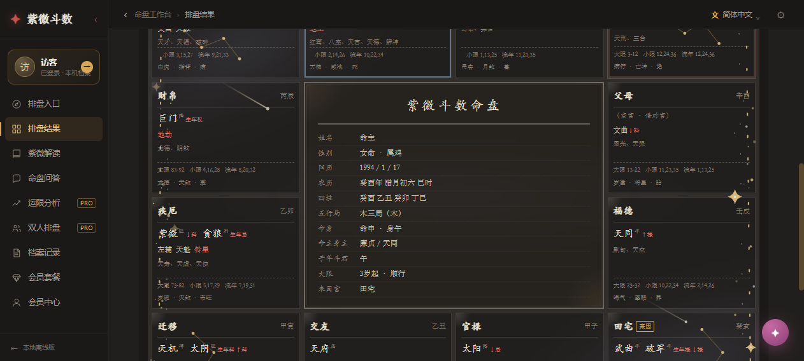

# Zi Wei Dou Shu Chart · 紫微斗数在线排盘

A **pure front-end, zero-dependency, offline-capable** Zi Wei Dou Shu (Purple Star Astrology) charting and analysis tool.

Enter a birth time → get a full 12-palace chart, an 11-volume in-depth report, and an 84-candle life K-line.
Everything is computed locally in your browser — **no network calls, no data upload, no account needed**.



---

## ✨ Features

| Module | Description |
|---|---|
| **New Chart** | Solar / lunar calendar input, 1900–2099, with hour branch and gender |
| **Chart Map** | Full 12-palace grid: major stars, auxiliaries, minor stars, four transformations, self-transformations, twelve officials |
| **Interpretation** | 11-volume report: chart map, core structure, 12-palace close reading, natal transformations, flying transformations, self-transformation chains, adjacencies & empty palaces, six life topics, decade cycles with annual fortunes, key events with monthly timing |
| **Chart Q&A** | 10 computed Q&A pairs for the current chart + free-form keyword questions |
| **Luck Analysis** | 84-candle life K-line (start value 1.000) with decade bands, hover for per-year trigger details, range switching |
| **Synastry** | Two-chart comparison across 9 dimensions + an 11-volume synastry report: life-palace resonance, marriage-palace dialogue, cross-chart transformations, self-transformation supply/demand, 12-theme complementarity matrix, luck resonance with monthly timing |
| **Languages** | 简体中文 / 繁體中文 / English (English mode adds a computed Executive Summary) |

## 🌐 Live Demo

- <https://YOUR-USERNAME.github.io/ziwei-chart/>
- Or download `紫微排盘_分享包.zip`, extract it, and double-click `命盘工作台.html` (single file, works fully offline)

## 📦 What's in the share package

```
紫微排盘_分享包/
├─ 开始.html              ← index page (ink-and-starry-sky style)
├─ 命盘工作台.html        ← main app · single self-contained file, zero dependencies
├─ 浅色水墨版.html        ← light rice-paper variant
├─ 分享页.html            ← QR-code generator page (paste any URL, instant re-render)
├─ 二维码与卡片/          ← QR codes + ink-style share cards
├─ site/                  ← full website source
├─ 启动局域网服务.bat      ← local LAN server for phone access
└─ 使用说明.txt
```

> ⚠️ **Windows users**: don't double-click files from inside the zip window. Windows only extracts
> that one file to a temp folder, so links break with `ERR_FILE_NOT_FOUND`. Use "Extract All…" first.

## 🛠 Technical notes

- **No framework, no build step, no external dependencies** — plain HTML / CSS / JavaScript
- **Charting engine** `js/chart.js`: life/body palace, five-element cycle, 14 major stars, auxiliaries,
  natal transformations, self-transformation chains, twelve officials, decade/minor/annual cycles,
  origin palace, triangular & opposite relationships
- **Lunar engine** `js/lunar-data.js`: 1900–2099 lunar month table, four pillars, five-tiger/five-rat escapes
- **Report generator** `js/report-core.js` + `js/report-extra.js`: every reading is derived from chart data at
  runtime — nothing is a hard-coded template
- **K-line model** `js/interpret.js` + `js/kline.js`: explainable OHLC fortune index, hand-drawn on Canvas
- **Style isolation**: reports and the K-line are hosted in `iframe srcdoc`, so the paper theme never
  bleeds into the dark workspace shell

**Engine accuracy**: core star-placement rules were regression-checked against real charts —
198 items (major stars, auxiliaries, palace stems, four pillars, five-element cycle, life/body rulers,
dou jun, decade/minor/annual cycles, minor stars) all matched, with separate verification of
self-transformation chains and the twelve officials.

## ⚖️ Disclaimer

This project is a technical implementation and academic presentation of traditional Chinese astrology
(Zi Wei Dou Shu). **All outputs are symbolic references and tendencies only, and do not constitute
medical, legal, financial, investment, or life-decision advice.**

## 📄 License

MIT
